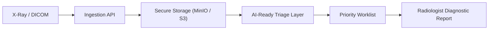
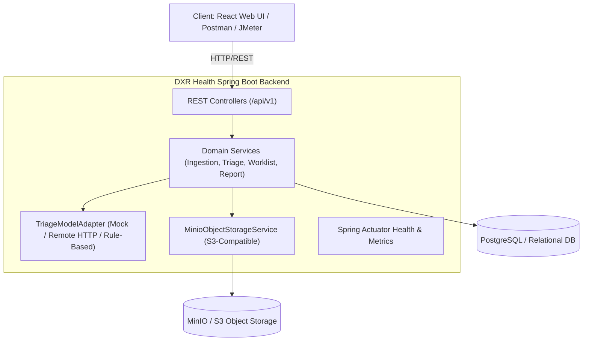
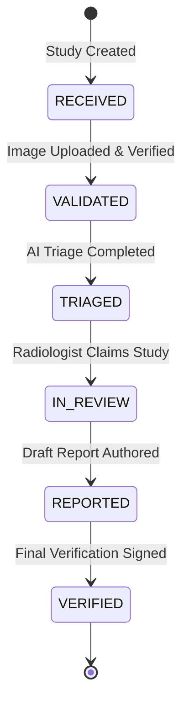

# DXR Health: Cloud-Native AI-Ready Diagnostic X-Ray Ingestion, Triage & Workflow Platform

[](https://spring.io/projects/spring-boot)
[](https://www.oracle.com/java/)
[](https://react.dev/)
[](https://www.docker.com/)
[](LICENSE)

> **Healthcare - Diagnostic X-Ray | GE HealthCare Precision Care Challenge 2026 Alignment**  
> *Educational prototype - synthetic/de-identified data only - AI output is triage support, not diagnosis.*

---

## 1. Executive Summary & Overview

Radiology teams face burgeoning imaging volumes where urgent critical studies can be delayed when systems treat new studies as an undifferentiated queue. **DXR Health** addresses this bottleneck with a cloud-ready Diagnostic X-Ray (DX/CR) platform that:
1. Ingests studies (DICOM, JPEG, PNG for demo) and persists image and study metadata.
2. Invokes a model-agnostic, failure-isolated AI triage layer.
3. Automatically calculates dynamic priority scores (`CRITICAL`, `HIGH`, `ROUTINE`) for the radiologist worklist.
4. Preserves graceful fallback to chronological ordering if AI inference fails or is offline.
5. Captures final human-authored diagnostic reports through a strict state machine (`RECEIVED` &rarr; `VALIDATED` &rarr; `TRIAGED` &rarr; `IN_REVIEW` &rarr; `REPORTED` &rarr; `VERIFIED`).

---

## 2. End-to-End Clinical Architecture & Workflow



### Detailed Component Architecture



---

## 3. Workflow State Machine

Studies strictly transition through verified healthcare quality gates:



- **Safety Rule**: AI output is an operational prioritization signal only. It never finalizes a diagnosis. The final report remains strictly human-authored.
- **Resilience**: An AI inference error or failure sets status to `FAILED`, preserving the study in the review queue with standard chronological ordering (no silent drops).
- **Immutability**: Once a study reaches `VERIFIED`, it is final and immutable.

---

## 4. Repository Structure

```text
DXR-Health/
├── backend/                       # Spring Boot 3.x REST Service
│   ├── src/main/java/com/dxr/health/
│   │   ├── ai/                    # Model-agnostic triage adapters
│   │   ├── config/                # Storage, AI, Security, Web configurations
│   │   ├── controller/            # REST API Controllers
│   │   ├── dto/                   # Data Transfer Objects & Validation
│   │   ├── exception/             # Centralized Error Handlers
│   │   ├── model/                 # JPA Domain Entities
│   │   ├── repository/            # Spring Data Repositories
│   │   ├── service/               # Domain Business Logic
│   │   └── storage/               # S3/MinIO Object Storage Service
│   ├── src/test/java/...          # Comprehensive JUnit 5 & MockMvc Test Suite
│   ├── pom.xml                    # Maven Configuration
│   ├── .env.example               # Backend environment variables template
│   └── README.md                  # Dedicated backend instructions
│
├── frontend/                      # React 18 + Vite + Tailwind/Modern UI
│   ├── src/
│   │   ├── components/            # Reusable UI widgets (Navbar, Badge, Modal, etc.)
│   │   ├── pages/                 # Worklist, Study Detail, Ingestion, Analytics
│   │   ├── services/              # API Client (Axios)
│   │   └── types/                 # TypeScript/JS definitions
│   ├── package.json
│   ├── .env.example               # Frontend environment template
│   └── README.md                  # Dedicated frontend instructions
│
├── docker-compose.yml             # Full-stack orchestrator (PostgreSQL, MinIO, Backend, Frontend)
├── .env.example                   # Root environment configuration
├── DXR-Health.postman_collection.json  # Complete automated Postman test suite
├── DXR-Local.postman_environment.json   # Postman environment variables
├── DXR-Health-Load-Test.jmx       # Apache JMeter performance test scenarios
└── samples/                       # Synthetic & de-identified test X-ray assets
```

---

## 5. Technology Stack

- **Backend**: Java 21, Spring Boot 3.3, Spring Data JPA, Jakarta Bean Validation, Spring Boot Actuator
- **Database**: PostgreSQL (Production / Docker), H2 In-Memory (Automated Testing)
- **Object Storage**: MinIO / S3-compatible SDK
- **Frontend**: React 18, Vite, Lucide Icons, Modern CSS
- **Testing & Quality**: JUnit 5, Mockito, MockMvc, Postman Newman, Apache JMeter
- **Deployment**: Docker & Docker Compose

---

## 6. Quick Start Guide

### Prerequisites
- Java 21+ & Maven 3.9+
- Node.js 20+ & npm
- Docker & Docker Compose (Optional for containerized run)

### Running Locally with Docker Compose
```bash
docker compose up -d
```
Services will be accessible at:
- Frontend UI: `http://localhost:3000`
- Spring Boot REST API: `http://localhost:8080`
- MinIO Object Storage Console: `http://localhost:9001`
- PostgreSQL: `localhost:5432`

---

## 7. Safety, Ethics & Scope Disclaimer
1. **Educational Prototype**: Built strictly for educational and demonstration purposes.
2. **De-identified Data**: Only synthetic and de-identified data are accepted and used. No real protected health information (PHI) is ever committed.
3. **Clinical Decision Support Only**: AI outputs are solely for workflow ordering and triage assistance. The radiologist is always the final clinical decision-maker.
